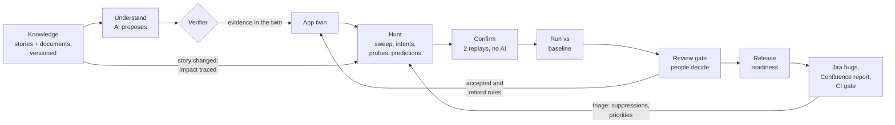
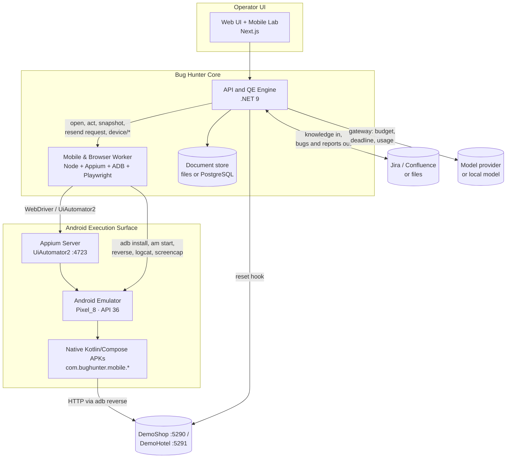

# Autonomous Bug Hunter for Mobile (Android · Appium · UiAutomator2)

[](https://github.com/abulslab/Autonomous-Bug-Hunter-Mobile/actions/workflows/ci.yml)
[](LICENSE)
[](android/apks/)
[](docs/adr/0012-android-appium-execution-surface.md)

**A continuous quality-engineering system for Android mobile applications.** Built directly on the architectural foundation of [`Autonomous-Bug-Hunter-Web`](https://github.com/abulslab/Autonomous-Bug-Hunter-Web), it learns what a mobile application should do from the team's stories and documents, explores it on an **Android Emulator (`Pixel_8`) with Appium (`UiAutomator2`) & ADB** (or fast mobile-viewport sessions in CI), reports only findings it can reproduce without AI, and turns each release into a decision backed by evidence.

This repository is a concrete proof of **architectural reusability** ([ADR 0011: The execution surface is a port](docs/adr/0011-the-execution-surface-is-a-port.md) & [ADR 0012: Android Emulator & Appium Execution Surface](docs/adr/0012-android-appium-execution-surface.md)): 100% of the core QE intelligence layer (versioned knowledge, the app twin, AI understanding & deterministic verifier, invariant rules, predictive twin, API probes, model-free confirmation replay, journeys, baselines, review gate, learning, and release readiness) is reused unchanged across Web and Mobile.

> **AI proposes, the engine verifies.**
> Models decide what is worth exploring and what should be true. Deterministic code decides what is a bug, on recorded
> evidence (`NetworkEvent`, screen hierarchy, and `adb logcat`), and replays it with no model in the loop. A model's opinion never becomes a finding by itself.

---

## Architectural Reusability: Web → Mobile

| Layer | Shared with [`Autonomous-Bug-Hunter-Web`](https://github.com/abulslab/Autonomous-Bug-Hunter-Web)? | Mobile Adaptation in `Autonomous-Bug-Hunter-Mobile` |
|---|---|---|
| **Versioned Knowledge (`Projects/`)** | **100% Reused** | Stories & documents from Jira/Confluence or files |
| **App Twin & Verifier (`Twin/`)** | **100% Reused** | Tracks mobile screens, API endpoints by role, entities, lifecycles, and verified rules |
| **Predictive Twin & Probes (`Twin/`, `Hunter/Probes.cs`)** | **100% Reused** | Checks role boundaries, lifecycle transitions, price consistency, and API boundary probes |
| **Confirmation, Journeys, Review, Readiness** | **100% Reused** | Two model-free replays, delta-debugging shrinker, baseline diffing, review gate, CI gate |
| **Execution Surface Port (`src/browser-worker`)** | **Adapted Port** | Manages **Android Emulator (`Pixel_8`)**, **Appium (`UiAutomator2` on `:4723`)**, **ADB (`install`, `am start`, `reverse`, `logcat`, `screencap`)**, and mobile viewport sessions |
| **Deterministic Oracles (`Hunter/Oracles.cs`)** | **Extended** | Adds `android-crash` (`FATAL EXCEPTION` in `AndroidRuntime`) and `android-anr` (`ANR in` `ActivityManager`) alongside money, validation, and consistency oracles |
| **Reproduction Specs (`Hunter/SpecWriter.cs`)** | **Extended** | Generates both **Appium WebdriverIO (`UiAutomator2`)** specs targeting the `.apk` package on `Pixel_8` and **Playwright** mobile specs |
| **Target Applications (`android/`)** | **New Native APKs** | Three real compiled **Kotlin + Jetpack Compose** Android `.apk` binaries in [`android/apks/`](android/apks/) |

---

## Real Native Android Target APKs (`android/`)

Unlike mobile-webview wrappers, this repository includes a full multi-flavor **Kotlin + Jetpack Compose** Android Gradle project in [`android/`](android/) and ships three prebuilt `.apk` binaries in [`android/apks/`](android/apks/):

| APK Binary | Android Package ID | Native Compose Screens & Capabilities | Backend / Port |
|---|---|---|---|
| [`android/apks/DemoShopMobile.apk`](android/apks/DemoShopMobile.apk) | `com.bughunter.mobile.shop` | **Catalog** (search, category chips, stock badges), **Cart & Checkout** (quantity stepper, coupon bar, gift wrap, payment form), **Orders** (cancel order), **Staff Order Desk** (`staff@shop.demo` session, ship/cancel), **Sign In** | `http://localhost:5290` (`adb reverse tcp:5290 tcp:5290`) |
| [`android/apks/DemoHotelMobile.apk`](android/apks/DemoHotelMobile.apk) | `com.bughunter.mobile.hotel` | **Rooms & Book** (dates, guest count, breakfast add-on, instant reservation), **My Stays** (guest lookup & cancellation), **Front Desk** (`desk@hotel.demo` sign-in, check-in, check-out) | `http://localhost:5291` (`adb reverse tcp:5291 tcp:5291`) |
| [`android/apks/VoiceAppointmentMobile.apk`](android/apks/VoiceAppointmentMobile.apk) | `com.bughunter.mobile.voice` | **Voice Assistant** (Android `SpeechRecognizer` + `TextToSpeech` clinic scheduling), **Chat**, **Visits**, **Settings**, plus an embedded **NanoHTTPD `/evaluate` server** on device port `8080` | Device `:8080` (`adb forward tcp:18080 tcp:8080`) |

All Compose interactive elements expose semantic Android resource IDs (`testTagsAsResourceId = true` + `Modifier.testTag(...)`) for reliable `UiAutomator2` locator resolution (`driver.$('id=...')`).

To rebuild the `.apk` binaries from source:

```bash
cd android
./gradlew assembleDebug --no-daemon
```

---

## How it works



## Architecture



Twelve architecture decision records explain the choices and the evidence behind them, from
[ADR 0001: the AI never decides what is a bug](docs/adr/0001-ai-proposes-engine-verifies.md) through
[ADR 0011: the execution surface is a port](docs/adr/0011-the-execution-surface-is-a-port.md) and
[ADR 0012: Android Emulator & Appium (`UiAutomator2`) execution surface](docs/adr/0012-android-appium-execution-surface.md).

---

## Quick start

### Setup: keys stay on your machine

The repository holds no keys or passwords. Everything the stack needs locally lives in a git-ignored `.env` at the
repository root:

| Variable | What it is | Where it comes from |
|---|---|---|
| `DEMO_SHOP_KEY` | Admin and test-reset key of the demo apps; the simulators' harness key | Generated on first run |
| `SIM_TOKEN` | API token of the Jira and Confluence simulators | Generated on first run |
| `GEMINI_API_KEY`, `ANTHROPIC_API_KEY`, `OPENAI_API_KEY` | Model providers, for AI strategies only | Your own key, optional |
| `BUGHUNTER_API_KEY` | Protects the API; required before anyone else can reach it | You choose it |
| `POSTGRES_PASSWORD` | Database password, only with the PostgreSQL store | You choose it |

`node scripts/dev.mjs` creates `.env` with random `DEMO_SHOP_KEY` and `SIM_TOKEN` values the first time it runs;
`node scripts/env.mjs` does the same without starting anything. To set values yourself, copy
[.env.example](.env.example) to `.env`. Never commit `.env`.

### Local (with Android Emulator & Appium)

Requirements:
- .NET 9 SDK and Node 20+
- Optional for live Android Emulator execution: Android SDK (`adb`, `emulator` with a `Pixel_8` AVD) and Appium (`npm install -g appium && appium driver install uiautomator2`)

```bash
npm --prefix src/web install
npm --prefix src/browser-worker install
node scripts/dev.mjs
```

Once running:
1. Open **http://localhost:3100** and click **Mobile Lab & APKs** in the top bar.
2. Click **Start Emulator & Appium** to boot the `Pixel_8` Android Emulator, configure `adb reverse` for ports `5290`/`5291`/`5299`, install `DemoShopMobile.apk`, `DemoHotelMobile.apk`, and `VoiceAppointmentMobile.apk`, launch the target app, and start Appium (`UiAutomator2`) on port `4723`.
3. Select **Demo Shop Mobile** or **Demo Hotel Mobile** to launch a hunt, watch the live Pixel 8 stream, and export confirmed findings as **Appium (`UiAutomator2`)** or **Playwright** reproduction tests.

### Docker

```bash
node scripts/env.mjs          # creates .env with local keys (or copy .env.example to .env and fill it in)
docker compose up --build
```

- Web UI: http://localhost:3100
- API and OpenAPI reference: http://localhost:5280/docs
- Demo Shop and Demo Hotel backends: http://localhost:5290, http://localhost:5291
- Jira and Confluence simulators: http://localhost:5292

---

## In CI

```bash
node scripts/smoke-hunt.mjs                                              # a hunt that fails the build on confirmed findings
node scripts/ci-gate.mjs --project hotel --out readiness.md --publish    # hunt what changed, then the release verdict
node scripts/workflow-demo.mjs --app hotel                               # sprint 1, triage, sprint 2, release, end to end
```

As a GitHub Action:

```yaml
- name: Bug Hunter Mobile release gate
  uses: abulslab/Autonomous-Bug-Hunter-Mobile@main
  with:
    api-url: ${{ vars.BUGHUNTER_API }}
    api-key: ${{ secrets.BUGHUNTER_API_KEY }}
    project: hotel
    environment: staging
    publish: true
```

---

## Repository

```
android/               Native Kotlin + Jetpack Compose Android project (shop, hotel, voice flavors)
android/apks/          Prebuilt real APK binaries: DemoShopMobile.apk, DemoHotelMobile.apk, VoiceAppointmentMobile.apk
src/BugHunter.Api      .NET 9 API: projects, twin, hunt engine, replay, runs, review, learning, workflow, model gateway
src/browser-worker     Node + Appium/ADB + Playwright worker: Android Emulator lifecycle, logcat/screencap, mobile sessions
src/web                Next.js UI with Mobile Lab (Emulator/Appium controls, Pixel 8 bezel monitor, Appium test export)
src/DemoShop           Ground-truth backend & mobile web surface: e-commerce, ten switchable seeded defects
src/DemoHotel          Ground-truth backend & mobile web surface: bookings, eight seeded business-rule defects
src/Simulators         Jira and Confluence simulators with the real REST shapes
ground-truth/          Answer keys, knowledge and multi-sprint scenarios for both demo apps
skills/                Skill packs: domain testing knowledge (including mobile-android.md) for the planner
scripts/               Dev launcher, CI gate, smoke hunt, benchmark harness, scenario runner, workflow demo
tests/                 xUnit unit and API tests (including mobile crash/ANR oracles and Appium SpecWriter tests)
docs/                  Architecture, ADRs (0001-0012), evaluation, benchmarks, configuration, extending, security, limits
```

## Documentation

| | |
|---|---|
| [Architecture](docs/architecture.md) | The problem, the continuous QE loop, layers, trust boundaries and failure modes, containers, hunt sequence |
| [Decisions](docs/adr/) | Twelve ADRs, including [ADR 0011](docs/adr/0011-the-execution-surface-is-a-port.md) and [ADR 0012](docs/adr/0012-android-appium-execution-surface.md) |
| [Reference run](docs/reference-run.md) | Two sprints end to end from an empty store: what was found, what was missed, what it taught |
| [Evaluation](docs/evaluation.md) and [Benchmarks](docs/BENCHMARKS.md) | Ground truth, metrics, threats to validity, how to reproduce |
| [Limits](docs/limits.md) | Protocols, state and replays, authentication, non-goals |
| [Configuration](docs/configuration.md) | Every setting |
| [Extending](docs/extending.md) | Rules, skill packs, oracles, routines, model providers, benchmark targets |
| [Security](docs/security.md) | Threat model and controls |
| [Roadmap](docs/roadmap.md) and [status report](docs/status-report.md) | What is done, what is next, every run including failures |

## Contributing

See [CONTRIBUTING.md](CONTRIBUTING.md). Licensed under the [MIT License](LICENSE).
